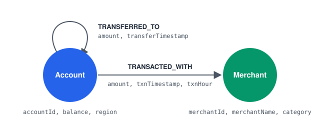

# Virtual Graph Demo

This project demonstrates the Neo4j Virtual Graph. The Virtual Graph gives you zero-copy
graph queries: you query tables in place with Cypher, and no data is copied into Neo4j.
It compiles Cypher into SQL and pushes most of the work down to the data source. Neo4j's
graph compute layer handles graph-specific operations. How much runs where depends on
the query.

The project runs on either of two data sources:

- **Databricks:** Aura reads Unity Catalog tables through a Databricks SQL warehouse.
- **AWS S3 Tables:** Aura reads Apache Iceberg tables in an Amazon S3 table bucket. A
  DuckDB engine embedded in the Virtual Graph instance runs the SQL.

The project walks through loading the Finance Genie sample data, creating a Virtual
Graph over it in Aura, and querying that graph. It also documents best practices, how to
use GDS Sessions, and the current limitations of the Virtual Graph.

Finance Genie is a synthetic dataset of bank accounts, merchants, and the transfers
between them. This demo uses only that synthetic dataset.

Virtual Graph is in public preview. The official docs advise against using sensitive or
production data with it during the preview. It is available to AuraDB Professional and
Business Critical customers. Billing started on 2026-09-01: instances use Aura Credits
based on their memory size, at parity with AuraDB Pro pricing. There is no GA date yet.
The [release notes](docs/release-notes.md) cover the latest engine update.

For further information, see:

- [Introducing Neo4j Virtual Graph](https://neo4j.com/blog/graph-database/introducing-neo4j-virtual-graph-graph-reasoning-on-the-data-you-already-have/)
- [Getting started with Databricks](https://neo4j.com/docs/virtual-graph/aura/getting-started-databricks/)

## The demos

This [uv](https://docs.astral.sh/uv/) Python project runs Cypher against the Finance
Genie Virtual Graph. It includes the following demo sets:

| Demo | What it is | Everything works? | Data source |
|---|---|---|---|
| `basic` | warm-up exploration and visualization queries | yes | both |
| `fraud` | fraud-signal queries 1-10 from [`finding-fraud.md`](docs/finding-fraud.md) | yes | both |
| `fast-gds` | the working GDS Session + PageRank path | yes | both |
| `gds-probe` | sweep numeric node / relationship property projections and show how to handle unsupported types | projects or skips unsupported properties | both |
| `gds-examples` | PageRank, WCC and Louvain on every transfer | not yet run live | both, at full scale on Databricks only |
| `100m` | the SQL-side "zero spill from 100K to 100M rows" spike, confirmed against warehouse query history | yes | Databricks only |

The queries build up gradually, from simple counts, through fraud-signal queries, to
graph algorithms like PageRank. You can see both what runs well and where the Virtual
Graph reaches its current limits.

Getting it running takes three steps:

1. Load the Finance Genie tables into your data source.
2. Build the Virtual Graph over those tables in Aura.
3. Run the demos from this project.

## Step 1: Set up a data source

Pick one data source. Both produce the same tables, and the graph model and the Cypher
demos are the same on either one.

### Databricks

The data stays in Unity Catalog. The setup notebook
[`notebooks/01_setup_lakehouse.ipynb`](notebooks/01_setup_lakehouse.ipynb) downloads
the dataset, stages the CSVs in a Unity Catalog Volume, and creates the base tables.
Aura then reads those tables through a SQL warehouse. You need a Databricks workspace
with permission to create a schema, a volume and tables.

Every demo runs on this setup. The `100m` demo and the `vg-generate` script run on
Databricks only.

Follow [`docs/setup-databricks.md`](docs/setup-databricks.md).

### AWS S3 Tables

The data lives in Iceberg tables inside an S3 table bucket. Aura connects to the table
bucket directly, so no Databricks workspace or SQL warehouse is involved. The setup
script [`aws/setup_s3_tables.py`](aws/setup_s3_tables.py) creates the table bucket,
loads the tables, and creates read-only credentials for Aura.

This is a preview path. The Aura console offers the S3 table bucket data source, but
the official Virtual Graph docs do not list it yet. The `100m` demo and `vg-generate`
do not apply here.

Follow [`docs/setup-aws.md`](docs/setup-aws.md). For how a query flows from Aura to the
table bucket, see [`docs/aws-architecture.md`](docs/aws-architecture.md).

## Step 2: Build the graph model



Both data sources map to the same graph:

- **Nodes:** Each row of `accounts` becomes an `:Account` node. Each row of `merchants`
  becomes a `:Merchant` node.
- **`TRANSACTED_WITH`:** Each row of `transactions` becomes a relationship from an
  account to the merchant it paid.
- **`TRANSFERRED_TO`:** Each row of `account_links` becomes a relationship from one
  account to another.
- **`account_labels`:** This table stays out of the graph. It holds the fraud ground
  truth used for evaluation.

The tables use snake_case column names. The graph uses camelCase property keys, so the
`account_id` column becomes the `accountId` property.

Follow [`docs/vg-model.md`](docs/vg-model.md) to create the Virtual Graph in Aura,
define the schema, add indexes, and run your first queries in the console.

## Step 3: Run the demos

Install [uv](https://docs.astral.sh/uv/). Create `.env` from the sample and fill in the
`NEO4J_*` values from the credentials file Aura gave you:

```bash
cp .env.sample .env
```

Run any demo from the project root. `uv run` installs the project and its dependencies
on first use:

```bash
uv run vg-demo                          # fraud demo (default): queries 1-10
uv run vg-demo --demo basic             # exploration / visualization queries
uv run vg-demo --demo fast-gds          # working PageRank path (7-day window)
uv run vg-demo --demo gds-probe         # sweep property projections (7-day window)
uv run vg-demo --demo gds-examples      # PageRank, WCC and Louvain on every transfer
```

[`docs/running-demos.md`](docs/running-demos.md) covers every `.env` setting, the flags,
and what each demo shows. It also covers the optional Databricks-only steps: the `100m`
demo and growing the graph with `vg-generate`.

## Documents

| Document | What it covers |
|---|---|
| [`docs/setup-databricks.md`](docs/setup-databricks.md) | Preparing Databricks as the data source: the Silver tables, the access token, and the Aura connection form. |
| [`docs/setup-aws.md`](docs/setup-aws.md) | Preparing an Amazon S3 table bucket as the data source: the Iceberg tables, the read-only credentials, and the Aura connection form. |
| [`docs/aws-architecture.md`](docs/aws-architecture.md) | How Aura queries Iceberg tables in an S3 table bucket. |
| [`docs/vg-model.md`](docs/vg-model.md) | Creating the Virtual Graph in Aura and building the graph model, plus when to model transactions as nodes. |
| [`docs/running-demos.md`](docs/running-demos.md) | Configuring `.env`, running each demo, its flags, and what it shows. |
| [`docs/basic-graph-examples.md`](docs/basic-graph-examples.md) | Warm-up counts, small traversals and console queries that show the graph's value without fraud logic. It backs `--demo basic`. |
| [`docs/finding-fraud.md`](docs/finding-fraud.md) | The fraud-signal queries and how to read them. It backs `--demo fraud`. |
| [`docs/best-practices.md`](docs/best-practices.md) | How to write Cypher that pushes down well, plus how the warehouse and the connection pool shape performance. |
| [`docs/gds-guide.md`](docs/gds-guide.md) | Running Graph Data Science through a GDS Session on a Virtual Graph, including the no-write-back constraint. |
| [`docs/release-notes.md`](docs/release-notes.md) | What changed in each Virtual Graph engine update and how it affected this project. |
