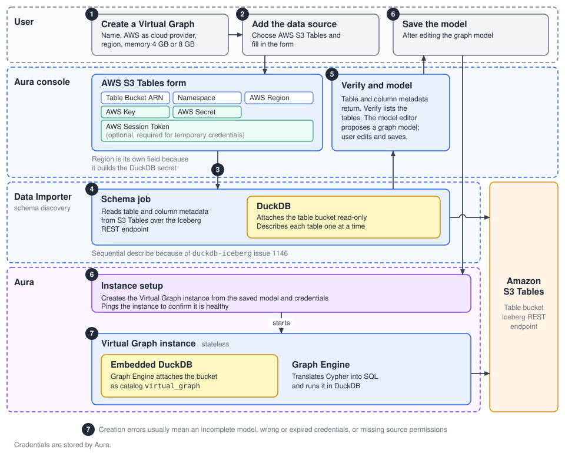

# Neo4j Virtual Graph on AWS: Architecture

An Iceberg table in Amazon S3 holds accounts, merchants, and transfers as rows. The question "which accounts sit three transfers from a flagged account" is a chain of self-joins in SQL and one path pattern in Cypher. The usual way to run Cypher on that data is to copy the rows into a graph store. The copy adds a pipeline, a second version of the data, and a window where the graph is stale.

Neo4j Virtual Graph removes the copy. A mapping declares which tables are nodes and which are relationships. Each Cypher query is translated to SQL, executed against the lakehouse, and returned as graph results. On AWS, the execution engine is DuckDB embedded in the Virtual Graph instance, and it reads Iceberg tables from an Amazon S3 table bucket. No warehouse or query cluster sits between the two.

This document describes how that path works, what each component does, and where the design is constrained.

> **Status:** This is not an official Neo4j document. Statements marked **Inferred** follow from the documented behavior and are not confirmed.

## What works on AWS today

| Path | Status on 2026-11-16 |
|---|---|
| Iceberg tables in an Amazon S3 table bucket, read through an Aura **AWS S3 Tables** data source | In production. |
| Iceberg tables behind the AWS Glue Data Catalog | The Data Importer connector for Glue exists. Graph Engine does not implement it yet. |
| Generic Iceberg REST catalog | Supported in the core database through DuckDB. No Aura data source exists for it. |
| Self-managed Enterprise Edition with DuckDB and an Iceberg catalog | Works with the DuckDB JDBC driver on the classpath. |

## Architecture at a glance


The diagram has two halves. The top half is the data path. Clients reach the Virtual Graph instance over Bolt. The Graph Engine inside the instance turns Cypher into SQL and hands it to an embedded DuckDB, and DuckDB reads Iceberg tables from the S3 table bucket with the user's AWS credentials. The bottom half is Aura. During setup, Aura reads table and column metadata from the same bucket. It then creates and configures the instance.

Three flows run across those components. Each has its own diagram.

### Query flow


A Cypher query enters over Bolt, becomes SQL inside the Graph Engine, and runs in the embedded DuckDB. DuckDB reads Iceberg data from S3 Tables. Rows come back through JDBC and are shaped into nodes and relationships. [Following one query](#following-one-query) walks through the same path with a concrete example.

### Setup flow



The Aura console collects a table bucket ARN, a namespace, and AWS credentials. A schema job in Data Importer reads table and column metadata so the model editor can propose a graph model. The saved model and credentials are handed to the Virtual Graph instance.

### Identity flow


One set of AWS credentials, supplied by the user, authorizes every read. Neo4j does not add row-level or traversal-level access rules on top. [Identity and access](#identity-and-access) lists the policy actions and the credential types.

## Components and their roles

### Amazon S3 table bucket and namespace

The table bucket is the system of record. It is an S3 bucket type built for Iceberg tables. A namespace groups tables inside it, like a schema. Namespace and table names allow only lowercase letters, numbers, and underscores.

Virtual Graph attaches one table bucket and maps tables from one namespace. A single Virtual Graph connects to a single data source. The bucket ARN identifies the bucket. The namespace picks the schema.

The setup in this repo creates the bucket and namespace, loads five Finance Genie tables with PyIceberg through the S3 Tables Iceberg REST endpoint, and creates a read-only IAM role. [setup-aws.md](setup-aws.md) walks through each step.

### Catalog access routes

An Iceberg catalog tells an engine where each table's metadata lives. Three routes reach S3-hosted Iceberg tables.

| Route | How it connects | Status |
|---|---|---|
| S3 Tables | The engine attaches the table bucket ARN directly. Access goes through the S3 Tables Iceberg REST endpoint. | Implemented in Graph Engine and in the Data Importer connectors. In the Aura console. |
| AWS Glue Data Catalog | The engine attaches a Glue catalog by account ID, catalog ID, and database. S3 Tables buckets also appear in Glue as the federated catalog `s3tablescatalog`. | Connector datasource exists. Graph Engine does not implement it. |
| Generic Iceberg REST | The engine attaches any Iceberg REST catalog. | Supported in the core database. Untested in the connectors. No Aura data source. |

### DuckDB, embedded

DuckDB is the engine that touches the lakehouse. It runs in-process inside the Graph Engine, so no separate cluster exists to size, secure, or pay for. The Graph Engine reaches it through the DuckDB JDBC driver.

- **Catalog attach:** The table bucket is attached inside DuckDB under the fixed catalog name `virtual_graph`. Every `schema.json` for S3 Tables must set `"catalog": "virtual_graph"`.
- **Iceberg access:** DuckDB uses its Iceberg extension and either the S3 Tables path or the Iceberg REST path. DuckDB does not copy the tables into its own storage first. The engine still requires an Iceberg catalog.
- **Credentials:** DuckDB receives an AWS secret built from the user's key, secret, optional session token, and region.
- **Schema discovery:** During setup, Data Importer attaches the same bucket read-only to list tables and columns. It uses this form:

```sql
ATTACH 'arn:aws:s3tables:<region>:<account-id>:bucket/<table-bucket>' AS s3_tables_catalog
  (TYPE iceberg, ENDPOINT_TYPE s3_tables, SECRET s3tables_secret, READ_ONLY,
   ACCESS_DELEGATION_MODE 'none');
```

Data Importer reads columns by describing each table one at a time. A large namespace therefore takes longer to discover.

### Graph Engine

The Graph Engine is the part of the Neo4j Cypher stack that turns graph queries into SQL. It is the same engine for every source. Only the dialect changes. The pipeline has seven steps.

1. Cypher is parsed by the standard Neo4j machinery into an AST.
2. The AST is rewritten and simplified.
3. An intermediate relational AST is built inside the Neo4j runtime.
4. A dialect chosen per target renders vendor-specific SQL. Snowflake, Databricks, BigQuery, and DuckDB each have their own rendering.
5. New **external operators** in the Cypher runtime run that SQL over JDBC.
6. A vendor-specific mapping turns result rows into graph values and preserves data types.
7. Some constructs finish in the engine. All predicates are pushed down.

Three properties follow from that design.

- **Predicates and joins push into SQL.** `EXPLAIN` shows a `GRAPH ENGINE` runtime with an `External` operator that holds the generated SQL. Window functions and common table expressions carry much of the work.
- **Quantified path patterns become recursive CTEs.** A pattern such as `{1,10}` over a transfer chain renders as `WITH RECURSIVE`. Property filters and relationship-uniqueness predicates sit inside the recursion, which prunes early.
- **Nothing persists.** The engine queries, builds a graph from the rows, and returns it. The graph is gone when the query ends. There is no ETL and no cache.

### Mapping files

Three JSON files describe a Virtual Graph on a self-managed server. In Aura, the platform stores the same content.

| File | Purpose |
|---|---|
| `datasource.json` | Names the source type and the table bucket ARN. |
| `secret.json` | Holds the AWS credential type and values. |
| `schema.json` | Maps tables to node labels and relationship types. |

## Following one query

The Finance Genie model maps `accounts` to `:Account` and `account_links` to `TRANSFERRED_TO`. The query below is illustrative. No source shows this exact query.

```cypher
MATCH (a:Account {accountId: $flagged})-[:TRANSFERRED_TO]->(:Account)-[:TRANSFERRED_TO]->(c:Account)
RETURN DISTINCT c.accountId
```

1. The Graph Engine parses the query and resolves the labels. `:Account` maps to the `accounts` table. `TRANSFERRED_TO` maps to `account_links`.
2. It builds a relational AST. Each hop is a join from `account_links` back to `accounts` on the mapped source and destination keys.
3. The DuckDB dialect renders SQL against the `virtual_graph` catalog and the namespace from `schema.json`.
4. The external operator sends the SQL over JDBC.
5. DuckDB reads the Iceberg metadata for each table through S3 Tables. It pushes the filter on `accountId` into the Iceberg scan. The joins run inside DuckDB.
6. Rows stream back. The engine shapes them into `:Account` nodes and returns the result.

The hop count never changes the Cypher. It changes the number of joins in the SQL, and each join runs in the instance's DuckDB.

## Provisioning paths

### Aura console

Create a Virtual Graph, choose AWS and a region, and add the **AWS S3 Tables** data source. The form takes these fields.

| Field | Meaning |
|---|---|
| Table Bucket ARN | The ARN of the S3 table bucket that holds the Iceberg tables. |
| Namespace | The namespace in that bucket. |
| AWS Key | Access key ID. |
| AWS Secret | Secret access key. |
| AWS Session Token | Required for temporary credentials. |
| AWS Region | The region of the bucket. |

Region is a separate field because the platform uses it to build the DuckDB secret. The ARN also contains a region.

The Connection and Verify steps list the tables. A successful verification shows every mapped table.

### Self-managed Enterprise Edition

The server needs the Enterprise build, the DuckDB JDBC driver in `lib`, and two settings. Aura does not expose these settings.

```
internal.virtual_graph.enabled=true
internal.virtual_graph.home=/path/to/folder
```

In Docker the same settings use double underscores, for example `NEO4J_internal_virtual__graph_enabled=true`. The folder holds the three JSON files. An image such as `neo4j:2026.09.0-enterprise` supports Virtual Graph. In Docker, mount the JDBC jar into `/var/lib/neo4j/lib/`.

Datasource:

```json
{
  "type": "iceberg",
  "catalogType": "S3_TABLES",
  "arn": "arn:aws:s3tables:us-east-1:123456789012:bucket/my-table-bucket"
}
```

The ARN must name the table bucket that backs the namespace to map. A wrong ARN fails startup or exposes the wrong data. List table buckets with `aws s3tables list-table-buckets`.

Schema header:

```json
{ "catalog": "virtual_graph", "schema": "my_namespace", "entities": {} }
```

The `schema` value is the namespace inside the table bucket.

## Identity and access

Authentication happens against AWS. The secret in `secret.json` is one of two types.

```json
{ "type": "aws.key", "keyId": "AKIA...", "secret": "...", "sessionToken": "..." }
```

```json
{ "type": "aws.chain", "chain": "sts", "role": "arn:aws:iam::123456789012:role/role" }
```

- **`aws.key`:** A static key and secret. `sessionToken` is optional and carries temporary credentials.
- **`aws.chain`:** Delegates to the AWS SDK. The default provider chain applies unless `chain` names one of `config`, `sts`, `sso`, `env`, or `web_identity`. The fields `profile`, `role`, `externalId`, and `tokenFile` refine each chain. `role` is required for `sts` and `web_identity`.
- **Optional fields on both types:** `region`, `endpoint`, `urlStyle` set to `vhost` or `path`, `useSsl` defaulting to true, and `autoRefresh` defaulting to false.

The Aura form accepts only the key, secret, session token, and region. The documentation for `aws.chain` comes from the self-managed description.

The existing read-only policy in [aura-s3tables-read.json](../aws/aura-s3tables-read.json) grants these S3 Tables actions on the bucket and its tables.

| Action | Purpose |
|---|---|
| `s3tables:GetTableBucket` | Read bucket properties. |
| `s3tables:ListNamespaces` and `s3tables:GetNamespace` | Discover the namespace. |
| `s3tables:ListTables` and `s3tables:GetTable` | Discover tables. |
| `s3tables:GetTableMetadataLocation` | Find Iceberg metadata. |
| `s3tables:GetTableData` | Read table data. |

Credentials from an SSO session last at most one hour. After they expire the Virtual Graph loses access until new values are pasted into the data source. A long-lived IAM user key avoids the refresh where an organization permits it.

Virtual Graph has no role-based access control on traversal. There is no stored graph, and Neo4j rules do not map to source-side row access. IAM scope on the credentials is the access boundary. Grant read-only actions on one table bucket.

Every Aura user queries as a reader. Only some project roles can create, change, or delete a Virtual Graph.

**Inferred:** An S3 failure surfaces as a credentials error in Data Importer, because DuckDB appends a generic authentication block to any object-store failure, including a 403. Check CloudTrail for the denied `s3tables` action before rotating keys.

### Observed AWS calls

DuckDB reaches the bucket through the S3 Tables Iceberg REST endpoint. In this test, AWS CloudTrail recorded four kinds of read-only management call from Aura:

- `s3tables:GetTableBucket`
- `s3tables:ListNamespaces`
- `s3tables:ListTables`
- `s3tables:GetTableMetadataLocation`

CloudTrail recorded no AWS STS calls from Aura. Aura uses the stored credentials exactly as entered and does not renew them. This is why expired credentials must be replaced by hand.

The trail did not log reads of the data files.

## Performance and memory

- **Filter pushdown:** In a DuckDB experiment on Iceberg tables, filters on leaf tables pushed into `ICEBERG_SCAN`. Join conditions ran as hash joins inside DuckDB. A filter on a join table pushed only because it was an attribute of that table.
- **Join tables:** A join table with many rows can grow in the instance's memory during execution.
- **Many labels:** `MATCH (n)` with many mapped labels produces a union across all node tables and can be slow.
- **Sizing:** Aura Virtual Graph instances come in 4 GB and 8 GB. For warehouse sources, most compute runs in the warehouse. **Inferred:** with Iceberg there is no warehouse, so the instance's memory bounds the DuckDB working set and the 4 GB and 8 GB sizes constrain large joins.

## Limitations

| Limitation | Detail |
|---|---|
| Read-only | No writes. |
| No `OPTIONAL MATCH` | Workarounds exist. |
| `WITH` restrictions | `LIMIT` in a `WITH` clause is unsupported. A `MATCH` after a `WITH` is not supported. |
| Time travel | Not supported. Iceberg time travel would need a snapshot predicate on every query. |
| Keys | Keys must be non-null. Composite node keys are rejected. |
| Naming | A relationship type cannot equal a node label. Relationship names must be unique in the graph. |
| Table mapping | One entity maps to one table or view. A predicate on a mapped table is unsupported. Use a view. |
| Relationship types | The type cannot come from a column value. |
| Source scope | One Virtual Graph connects to one data source. Composite graphs in Aura are not available. |
| Caching | None. Every query reads the source. |
| Traversal security | No RBAC on traversal. |
| Latency | Seconds to minutes for non-trivial queries, against milliseconds for a native graph. |
| Tooling | The Aura MCP server does not work with Virtual Graph. A self-managed MCP server or Aura Agent does. |
| Aura Agent | A project that holds only a Virtual Graph cannot create an agent. |
| Catalogs | Only the S3 Tables route is available in Aura. |

## Operations on Aura

- **Pause:** A Virtual Graph can be paused. Pausing closes connections and stops billing.
- **Creation errors:** The common causes are an incomplete model, wrong or expired credentials, and missing source permissions. The console does not show the underlying error to customers.
- **Billing:** The customer pays for the Aura instance. For warehouse sources the customer also pays warehouse costs. Neo4j describes a data plan for egress. **Inferred:** for Iceberg on S3 Tables the AWS cost lines are S3 Tables storage, requests, and automatic maintenance, as [setup-aws.md](setup-aws.md) states.
- **Data at rest:** Credentials are stored by the platform.

## Graph analytics and agents

- **GDS:** `gds.graph.project` runs over a Virtual Graph match and projects an in-memory graph. GDS Sessions can attach to a Virtual Graph. The Python client detects the instance type from the connected database.
- **Aura Graph Analytics:** Listed as a supported tool in the launch announcement.
- **Agents:** Aura Agent works with a Virtual Graph that shares a project with an AuraDB instance.
- **Fit:** The Finance Genie demos use the same graph model as the Databricks setup. Only the data source changes. See steps 4 to 6 of [setup-aws.md](setup-aws.md).

## References

- [Virtual Graph data sources](https://neo4j.com/docs/virtual-graph/aura/data-sources/)
- [Virtual Graph self-managed documentation](https://neo4j.com/docs/virtual-graph/self-managed/)
- [Amazon S3 Tables Iceberg REST endpoint](https://docs.aws.amazon.com/AmazonS3/latest/userguide/s3-tables-integrating-open-source.html)
- [Access management for S3 Tables](https://docs.aws.amazon.com/AmazonS3/latest/userguide/s3-tables-setting-up.html)
