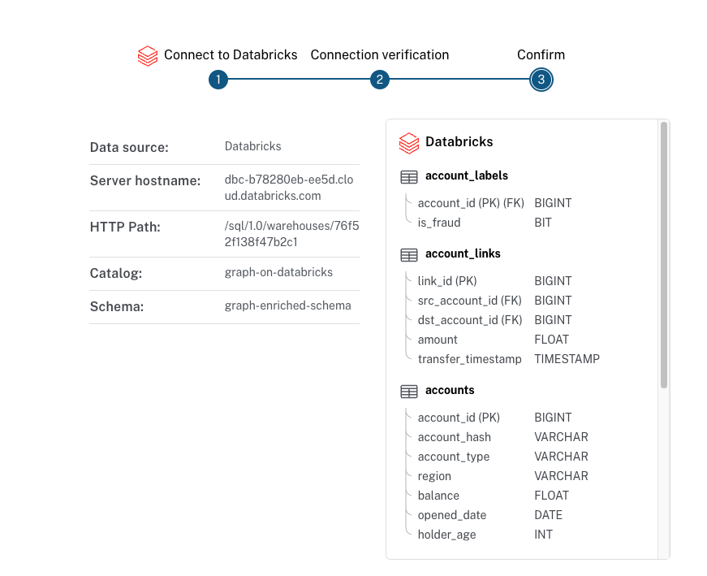

# Databricks Setup for the Finance Genie Virtual Graph

This guide prepares Databricks as the data source for the Finance Genie Virtual Graph. The data stays in Unity Catalog, and Aura reads it through a Databricks SQL warehouse. After this guide, build the graph in [`vg-model.md`](vg-model.md).

To run the Virtual Graph on AWS S3 Tables instead, follow [`setup-aws.md`](setup-aws.md).

## 1. Create the Silver tables

Before setting up the Virtual Graph, run [`notebooks/01_setup_lakehouse.ipynb`](../notebooks/01_setup_lakehouse.ipynb) in your Databricks workspace. It downloads the Finance Genie dataset, stages the CSVs into a Unity Catalog Volume, and creates the base tables. The Virtual Graph reads those tables, so they must exist first. The notebook's configuration cell sets the catalog, schema and volume. The defaults are `virtual-graph-dbx`, `vg-schema` and `raw-data`.

The tables you will model are the Finance Genie Silver tables: `accounts`, `merchants`, `transactions`, and `account_links`. The `account_labels` table stays out of the graph. It holds the fraud ground truth used for evaluation, not graph structure.

## 2. Prepare Databricks

Aura connects to Databricks over a SQL warehouse using a personal access token. Collect the following from your Databricks workspace.

### Create an access token

1. Select **Settings** from the user menu at the top right.
2. Select **Developer** under **User** in the **Settings** menu.
3. Select **Manage** next to **Access tokens**.
4. In the **Generate new token** menu, enter a name and a lifetime in days, and select `sql` as the API scope.
5. Select **Generate** and copy the token.

Virtual Graph needs only read-only access to the data source. The official docs say to limit tokens and other authentication to read-only access. Aura runs every generated SQL query as the token's principal, not as the Neo4j user, so Unity Catalog permissions and row filters apply. Grant that principal `USE CATALOG`, `USE SCHEMA`, and `SELECT` on the Finance Genie schema, plus `CAN USE` on the SQL warehouse. Consider a dedicated service principal rather than a personal token. Virtual Graph checks that every mapped table and column is readable at startup and fails if the principal cannot access one.

### Look up the server information

To find your **Server hostname** and **HTTP Path**:

1. Select **SQL Warehouses** from the left-side navigation.
2. Select the SQL warehouse you want to query through.
3. Open the **Connection details** tab to read the **Server hostname** and **HTTP Path**.

To find your catalog and schema:

1. Select **Catalog** from the left-side navigation.
2. Select your catalog.
3. The **Overview** tab lists the available schemas.

For Finance Genie, the catalog and schema are the ones the setup notebook created. The notebook sets them as `CATALOG` and `SCHEMA` in its configuration cell. The defaults are `virtual-graph-dbx` and `vg-schema`.

## 3. Connect Databricks as the data source

Create the Virtual Graph as [section 1 of `vg-model.md`](vg-model.md#1-create-the-virtual-graph-in-aura) describes. When you select **Add new data source**, choose **Databricks** and complete the form:

- Assign the data source a name.
- Enter the **Server hostname** and **HTTP Path** from the SQL warehouse connection details.
- Enter the personal access token you generated.
- Enter the **Catalog** and **Schema** that hold the Finance Genie tables.

Select **Next** and wait for the connection to be verified, then **Confirm**.

### Confirm the setup worked

When the connection verifies, the **Confirm** step lists your Databricks data source along with the discovered tables and columns. A successful Finance Genie setup looks like this:

The panel shows the data source set to Databricks with the server hostname, HTTP path, catalog, and schema you entered. The discovered tables appear on the right. The table list is scrollable, and the screenshot shows the top of it.

The screenshot comes from an earlier setup. It shows the catalog `graph-on-databricks` and the schema `graph-enriched-schema`. Its `accounts` table has no `account_name` column. With the notebook defaults, your panel shows `virtual-graph-dbx` and `vg-schema`, and these tables:

- `account_labels` with `account_id` and `is_fraud`
- `account_links` with `link_id`, `src_account_id`, `dst_account_id`, `amount`, and `transfer_timestamp`
- `accounts` with `account_id`, `account_hash`, `account_name`, `account_type`, `region`, `balance`, `opened_date`, and `holder_age`
- `merchants` with `merchant_id`, `merchant_name`, `category`, and `region`
- `transactions` with `txn_id`, `account_id`, `merchant_id`, `amount`, `txn_timestamp`, and `txn_hour`

Scroll down to see `merchants` and `transactions`. All five Silver tables are discovered. Seeing these tables and columns confirms that Aura can reach the warehouse and read the Finance Genie schema.

## 4. Build the graph model

Continue with [section 2 of `vg-model.md`](vg-model.md#2-select-a-graph-model) to select and define the graph model, then inspect the graph.

## Keep learning

- [Quickstart: Databricks](https://neo4j.com/docs/virtual-graph/aura/getting-started-databricks/) for the source workflow this walkthrough is based on.
- [GraphAcademy: Virtual Graph with Databricks](https://graphacademy.neo4j.com/courses/virtual-graph-databricks) for a guided course.
