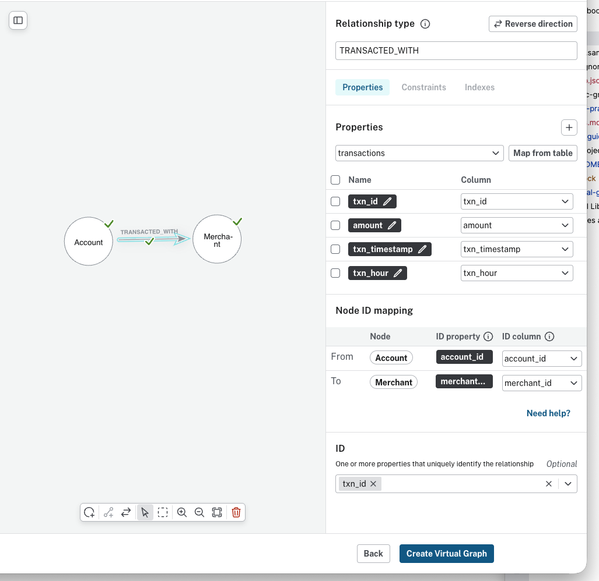
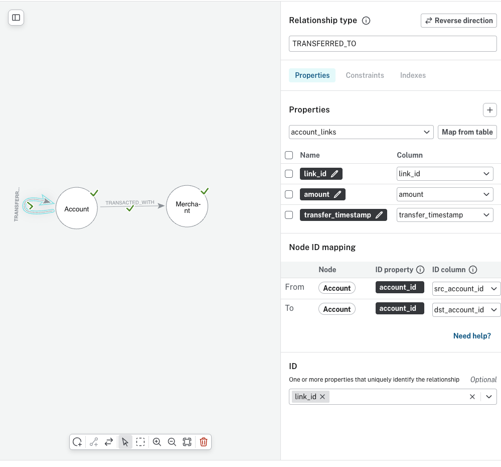
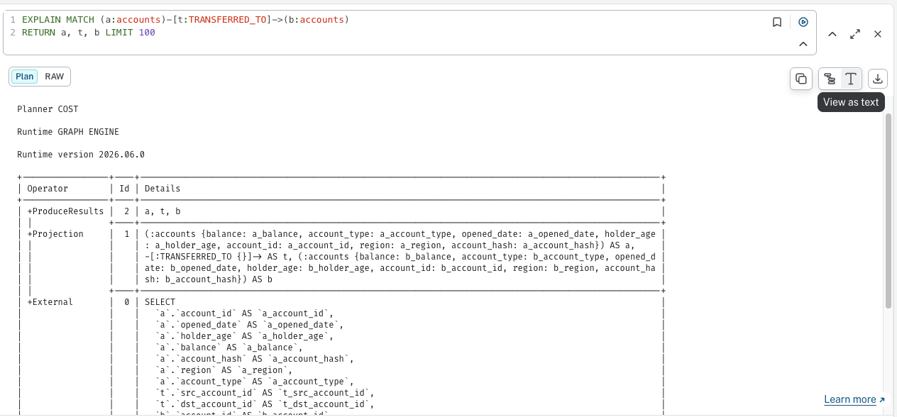

# Build the Finance Genie Virtual Graph

Neo4j Virtual Graph lets you query tables in your data source as a property graph in Aura without copying the data into Neo4j first. This walkthrough creates the Virtual Graph in Aura and builds the Finance Genie graph model over the Finance Genie tables, so you can explore accounts and transfers with Cypher while the data stays in place.

> Virtual Graph is in public preview. The official docs advise against using sensitive or production data with it during the preview. It is available to AuraDB Professional and Business Critical customers. Billing started on 2026-09-01, and instances use Aura Credits based on their memory size.
>
> Start with a small test dataset to get a feel for the query traffic Virtual Graph generates. The docs warn that large datasets combined with computation-heavy queries might incur unexpected costs.

Set up a data source before you start. Each setup guide creates the Finance Genie tables and the credentials Aura uses to read them:

- [`setup-databricks.md`](setup-databricks.md) for Databricks Unity Catalog tables behind a SQL warehouse.
- [`setup-aws.md`](setup-aws.md) for Apache Iceberg tables in an Amazon S3 table bucket.

The graph model and every Cypher demo are the same for both sources. Only the data source changes.

## 1. Create the Virtual Graph in Aura

In the Aura console:

1. Select **Instances** from the left-side navigation.
2. Open the **Virtual Graphs** tab and select **Create virtual graph**.
3. In the **Configure Virtual Graph** step, choose a name, a cloud provider, and a memory volume. On AWS, choose the same region as your table bucket.
4. Select **Add new data source** and choose your source. Complete the form as your setup guide describes:
   - [Databricks data source form](setup-databricks.md#3-connect-databricks-as-the-data-source)
   - [S3 table bucket data source form](setup-aws.md#step-4-connect-the-s3-table-bucket-in-aura)
5. Select **Next** and follow the wizard until it verifies the connection and lists the tables, then select **Confirm**.

When the connection verifies, the **Confirm** step lists your data source along with the discovered tables and columns. A successful Finance Genie setup lists five tables: `account_labels`, `account_links`, `accounts`, `merchants`, and `transactions`. Seeing them confirms that Aura can reach the data source and read the Finance Genie schema.

## 2. Select a graph model

Under **Select graph model**, choose **Create new graph model**. You populate this empty model in the next step.

The model editor offers three ways to start: **Define manually**, **Generate from schema**, and **Generate with AI**. This walkthrough uses **Generate from schema**, which enforces unique node labels and relationship types. The docs note that a model generated with AI cannot guarantee that uniqueness, so check any AI-generated model before saving it.

## 3. Define your schema

**Generate from schema** turns every discovered table into a node, including the `transactions` and `account_links` join tables. The Finance Genie graph needs those two tables modeled as relationships instead, and it leaves `account_labels` out of the graph entirely. The label is the fraud ground truth, so keeping it out of the graph preserves it as a held-out evaluation target rather than a feature.

The target model is two node types and two relationship types:

- `:Account` nodes from the `accounts` table
- `:Merchant` nodes from the `merchants` table
- `TRANSACTED_WITH` relationships from `:Account` to `:Merchant`, built from the `transactions` table
- `TRANSFERRED_TO` relationships from `:Account` to `:Account`, built from the `account_links` table

The names follow Neo4j conventions. Node labels are singular PascalCase, such as `Account`. Relationship types are UPPER_SNAKE_CASE, such as `TRANSFERRED_TO`. The source tables keep their plural SQL names, such as `accounts`. The model maps one to the other. Every query in this project uses `:Account` and `:Merchant`, so they fail against a model that still has the generated `:accounts` and `:merchants` labels.

Property names follow the same split. The source columns use SQL snake_case names, such as `account_id`. The graph uses camelCase property names, such as `accountId`. The Virtual Graph model maps each column to its property. Every query in this project uses the camelCase property names. If you built the model before the properties were renamed, rename them now as step 6 describes. A query that names a missing property reads it as null, so the demos return no rows instead of an error.

Build that model with the following steps.

1. Remove `account_labels` from the data source so Aura does not model it.
2. Select **Generate from schema**. Aura maps the remaining tables to nodes and relationships.

   > **On S3 table buckets:** Iceberg tables carry no foreign keys, so **Generate from schema** has fewer hints to work with. The next step deletes every generated relationship anyway, so the result is the same.

3. Remove every relationship Aura generated. You will recreate the two you need by hand so the node ID mappings are explicit.
4. Remove the `transactions` and `account_links` nodes. These are edge tables and become relationships, not nodes.
5. Rename the two remaining node labels. **Generate from schema** labels each node after its table, so the nodes arrive as `accounts` and `merchants`. Change the label of `accounts` to `Account` and the label of `merchants` to `Merchant`. Leave the backing tables unchanged.
6. Rename the properties. **Generate from schema** names each node property after its column, so the properties arrive in snake_case. In the model editor, rename every `Account` and `Merchant` property to the name in the table below. Leave the mapped columns unchanged. The relationship properties get their names in the next two steps, when you create the relationships. The table lists every property in the model, so you can tick each one off. A row whose column and property match needs no rename.

   | Element | Column | Property |
   |---------|--------|----------|
   | `Account` | `account_id` | `accountId` |
   | `Account` | `account_hash` | `accountHash` |
   | `Account` | `account_name` | `accountName` |
   | `Account` | `account_type` | `accountType` |
   | `Account` | `region` | `region` |
   | `Account` | `balance` | `balance` |
   | `Account` | `opened_date` | `openedDate` |
   | `Account` | `holder_age` | `holderAge` |
   | `Merchant` | `merchant_id` | `merchantId` |
   | `Merchant` | `merchant_name` | `merchantName` |
   | `Merchant` | `category` | `category` |
   | `Merchant` | `region` | `region` |
   | `TRANSACTED_WITH` | `txn_id` | `txnId` |
   | `TRANSACTED_WITH` | `amount` | `amount` |
   | `TRANSACTED_WITH` | `txn_timestamp` | `txnTimestamp` |
   | `TRANSACTED_WITH` | `txn_hour` | `txnHour` |
   | `TRANSFERRED_TO` | `link_id` | `linkId` |
   | `TRANSFERRED_TO` | `amount` | `amount` |
   | `TRANSFERRED_TO` | `transfer_timestamp` | `transferTimestamp` |

7. Create the `TRANSACTED_WITH` relationship, as shown below:

   - Set the **Relationship type** to `TRANSACTED_WITH`.
   - Under **Properties**, map from the `transactions` table:

     | Property | Type | Map from column |
     |----------|------|-----------------|
     | `txnId` | integer | `txn_id` |
     | `amount` | float | `amount` |
     | `txnTimestamp` | datetime | `txn_timestamp` |
     | `txnHour` | integer | `txn_hour` |

     Set the **id** to `txnId`.
   - Under **Node ID mapping**, set **From** to `Account`, with ID property `accountId` mapped from ID column `account_id`.
   - Set **To** to `Merchant`, with ID property `merchantId` mapped from ID column `merchant_id`.

   

   The screenshots in this step and the next predate the property rename. They show snake_case property names such as `txn_id`. Enter the camelCase names from the tables instead.

8. Create the `TRANSFERRED_TO` relationship, as shown below. Both ends map to the `Account` node. The source and destination differ only by which column supplies the ID:

   - Set the **Relationship type** to `TRANSFERRED_TO`.
   - Under **Properties**, map from the `account_links` table:

     | Property | Type | Map from column |
     |----------|------|-----------------|
     | `linkId` | integer | `link_id` |
     | `amount` | float | `amount` |
     | `transferTimestamp` | datetime | `transfer_timestamp` |

     Set the **id** to `linkId`.
   - Under **Node ID mapping**, set **From** to `Account`, with ID property `accountId` mapped from ID column `src_account_id`.
   - Set **To** to `Account`, with ID property `accountId` mapped from ID column `dst_account_id`.

   

   The `txn_timestamp` and `transfer_timestamp` columns hold UTC timestamps. Compare the `txnTimestamp` and `transferTimestamp` properties against zoned literals such as `datetime("2024-03-23T23:58:00Z")`, as every query in this project does.

   > **On Databricks:** The columns are Databricks `TIMESTAMP` columns. The engine reports the properties as `LOCAL DATETIME` in `db.schema.relTypeProperties()`. The values themselves come back as UTC datetimes, and `valueType()` reports them as `ZONED DATETIME`.

9. Select **Create Virtual Graph** to save the model, and download the credentials file when prompted. Put the connection URI and password in `.env`. The instance password cannot be changed later and is not recoverable. If you lose it, you must delete and recreate the Virtual Graph.

## Indexes for the model

The model editor exposes an **Indexes** tab on both nodes and relationships, alongside the
**Properties** and **Constraints** tabs. Add an index with `+` and pick a property. The
index type is Neo4j's default `range` index.

On a Databricks Virtual Graph, the model editor showed four indexes after the steps
above, all created for you. They are not visible from Cypher, because `SHOW INDEXES`
returns no rows on that Virtual Graph. This has not been checked on an S3 table bucket
source yet. The four indexes are:

- `Account.accountId` and `Merchant.merchantId`, the range indexes that back each node's
  ID uniqueness constraint.
- `TRANSACTED_WITH.txnId` and `TRANSFERRED_TO.linkId`, from the optional relationship
  **ID** property set on each relationship.

None of those sit on the columns the demo queries filter by. The fraud queries that
filter use timestamps, amounts, and account dates, and so does the GDS session window.
The Aura Import guidance is to add a range index to any property you regularly filter by
range. The additions below follow that guidance for the queries in
[`finding-fraud.md`](finding-fraud.md) and the GDS path in
[`gds-guide.md`](gds-guide.md). Their effect on a Virtual Graph is unmeasured. See the
caveat after the table.

| Index | Type | Backs |
|-------|------|-------|
| `TRANSFERRED_TO.transferTimestamp` | range | The GDS session window `WHERE t.transferTimestamp >= $since`, Collection accounts (query 5), Spray accounts (query 6), and the collection and spray finder queries. It matches the most filters. |
| `TRANSFERRED_TO.amount` | range | Structuring (query 1), the selective `>= 9000 AND < 10000` filter. |
| `Account.openedDate` | range | New accounts moving large sums (query 2). |
| `Account.balance` | range | Velocity ratio (query 4). |
| `TRANSACTED_WITH.txnTimestamp` | range | No demo query filters on it. Shared-merchant burst (query 9) groups by its day. Add it for queries that filter merchant transactions by time. |

For the GDS session specifically, the projection query is
`MATCH (src:Account)-[t:TRANSFERRED_TO]->(dst:Account) WHERE t.transferTimestamp >= $since`.
The index that matches it is `TRANSFERRED_TO.transferTimestamp`. The fan-in and fan-out
fraud queries filter on the same property.

Skip these, with the reason:

- `Account.accountId` and `Merchant.merchantId` are already indexed by their uniqueness
  constraints, so the anchored visualization lookups such as `{accountId: 184}` are
  already covered.
- `accountType`, `region`, and merchant `category` are `GROUP BY` keys, not selective
  range filters. A range index does not help a grouping scan.
- `txnHour` and `holderAge` are not filtered selectively by any demo query.
- `TRANSACTED_WITH.amount` has no range filter in the current fraud query set. Add it later
  only if a merchant-amount threshold query joins the set.

One caveat applies. Whether a model range index changes a Virtual Graph's execution is
unverified. Every performance lever in [`best-practices.md`](best-practices.md) is query
shape, warehouse size, or the connection pool. The backing tables have no B-tree index
for a range index to translate into. That holds for Delta tables on Databricks and for
Iceberg tables on S3. Treat these additions as a near-zero-cost way
to align the model with Neo4j and Aura Import best practice. They carry no measured
speed-up. The proven levers stay the ones in
[`best-practices.md`](best-practices.md): scalar group keys, time windows to keep result
sets small, warehouse size, and one query at a time. To check the effect of an index,
prefix a query with `EXPLAIN` and compare the generated SQL and timing before and after
adding it.

## 4. Inspect your graph

Select **Query** from the left-side navigation and run Cypher against the Virtual Graph. Aura compiles each query into SQL and pushes most of the work to the data source. Graph-specific operations run in Neo4j's graph compute layer.

> **Where the SQL runs:** On Databricks, the SQL runs on your SQL warehouse. On an S3 table bucket, it runs in a DuckDB engine embedded in the Virtual Graph instance, which reads the Iceberg tables directly. See [`aws-architecture.md`](aws-architecture.md) for the S3 Tables query flow.

### Transfers between accounts

To see transfers between accounts:

```cypher
MATCH (a:Account)-[t:TRANSFERRED_TO]->(b:Account)
RETURN a, t, b LIMIT 100
```

To see the Cypher-to-SQL translation, add `EXPLAIN` to the front of the query:

```cypher
EXPLAIN MATCH (a:Account)-[t:TRANSFERRED_TO]->(b:Account)
RETURN a, t, b LIMIT 100
```

`EXPLAIN` returns the query plan with the generated SQL instead of running the query. This plan comes from a Databricks Virtual Graph:



For more queries to run in the console, see
[`basic-graph-examples.md`](basic-graph-examples.md). It covers counts, breakdowns,
anchored visualizations, and the pushdown demonstrations.

When the queries return accounts and their transfers, the Finance Genie Virtual Graph is live and reading directly from your data source.

## Keep learning

- [Virtual Graph data sources](https://neo4j.com/docs/virtual-graph/aura/data-sources/) for other connection options.
- [Virtual graph models](https://neo4j.com/docs/virtual-graph/aura/models/) for schema fine-tuning and entity type uniqueness.
- [Cypher coverage](https://neo4j.com/docs/virtual-graph/aura/cypher-coverage/) for the current Cypher limitations.
- [SQL queries](https://neo4j.com/docs/virtual-graph/aura/sql-queries/) for reading the generated SQL with `EXPLAIN`.
- [GDS](https://neo4j.com/docs/virtual-graph/aura/gds/) for running graph algorithms through GDS Sessions.

Each setup guide lists the resources specific to its source.

## When to model transactions as nodes

This walkthrough maps the `transactions` and `account_links` fact tables to relationships rather than nodes. That is a deliberate modeling choice, and it is the correct one for the current scope.

The Neo4j rule is to model a connection as a relationship and only promote it to a node when one of these holds:

- The connection links three or more entities, so a relationship cannot express it.
- Something else needs to point at the event itself, such as a dispute, a chargeback, a device, or another transaction in a chain.
- The event is a first-class entity you traverse to, sequence over time, or run graph algorithms over.
- The event carries rich attributes you expect to grow well beyond a few scalar fields.

A Finance Genie transaction meets none of these today. It is a clean bipartite fact: one account, one merchant, with the `amount`, `txn_timestamp`, and `txn_hour` columns mapping directly onto the `amount`, `txnTimestamp`, and `txnHour` relationship properties. The `txn_id` primary key carries over as a relationship property when you need stable edge identity. Transfers in `account_links` are the same shape: a single account-to-account dyad that belongs on a `TRANSFERRED_TO` relationship. The relationship model is also cheaper in a Virtual Graph, where every node hop becomes an additional SQL join against the data source.

Reconsider and promote transactions to a `:Transaction` node when the data crosses one of the thresholds above. The common triggers in fraud work are:

- Money-flow chains, where you trace funds through a sequence of linked transactions to detect layering or mule activity.
- A third entity attaching to the event, such as a device, IP, session, or a dispute record that references a specific transaction.
- Shared-event motifs, where many accounts funnel into one event and the transaction node is the shared center.
- Graph algorithms run over the event graph itself.

When that happens, the upgrade path is `(:Account)-[:PERFORMED]->(:Transaction)-[:PAID_TO]->(:Merchant)`, using `txnId` as the node key.
